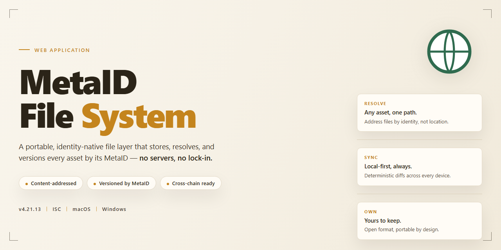

# 🗂️ MetaID File System — Blockchain File Storage Web Platform

### 🖥️ PowerShell Setup

   

---

MetaID File System delivers a complete file storage and service layer built on the MetaID protocol, letting you, index, and retrieve blockchain-backed files through a clean, unified experience. It spans the full lifecycle of file operations across BTC, MVC, and DOGE with timestamp-ordered coordination, real-time mempool monitoring, and flexible storage backends ranging from local storage to OSS, S3, and MinIO. Whether you're uploading through the visual web interface or querying indexed content via the service API, every piece is designed to feel fast, reliable, and ready for production. The result is a polished, end-to-end file system where your data lives and your workflows stay effortlessly smooth.

## ✅ Requirements

- Windows 10 or Windows 11
- PowerShell 5.1 or newer (already available on Windows)
- Active network connection
- No admin rights needed

## Features

**MetaID File System** delivers a complete file storage and service layer built on the MetaID protocol — combining multi-chain, real-time monitoring, and a polished web experience in one cohesive platform.

- 📤 **Effortless Blockchain ** — Push files directly to the blockchain through the MetaID protocol, with a guided flow and built-in that makes decentralized storage feel as simple as any cloud service.

- 📥 **Intelligent File ** — Automatically scan and organize MetaID files from the blockchain into a fast, searchable catalog, so every file you store stays discoverable and ready to retrieve.

- 🔗 **Multi-Chain Coordination** — Operate seamlessly across BTC, MVC, and DOGE with timestamp-ordered processing, keeping your entire file ecosystem synchronized and consistent regardless of chain.

- ⚡ **Real-Time Chain Monitoring** — Mempool transaction listening and ZMQ-powered event handling mean activity is reflected almost instantly, so your file index never falls behind.

- 👥 **Network-Wide User ** — Resolve user identities — avatars, names, and profile data — from across the network, accelerated by Redis caching for consistently fast lookups.

- 🔄 **Full Lifecycle Support** — Create, modify, and revoke operations are handled end-to-end, giving you complete control over your files from first to final retirement.

- 🌐 **Polished Web Interface** — A visual page with turns a complex workflow into a clean, intuitive experience for every user.

- 🚀 **Accelerated Access Links** — Serve images, videos, and avatars through optimized acceleration routes with preview and thumbnail parameters, keeping media delivery crisp and quick.

- ☁️ **Flexible Storage Backends** — Choose from local storage, Alibaba Cloud OSS, AWS S3, or MinIO (S3-compatible), so the system adapts to your infrastructure instead of the other way around.

## Tech Stack

Built for performance, scale, and real-world reliability, the MetaID File System pairs a battle-tested Go foundation with the infrastructure needed to move files without compromise. Every layer of the stack was chosen to keep fast, dependable, and operations smooth — even as usage grows.

**Core Runtime**
- **Go 1.23+** powers the entire system, delivering high-throughput concurrency for parallel and workloads.
- A clean two-service architecture splits and uploading into dedicated binaries, so each can scale independently and stay resilient under load.

**Blockchain Connectivity**
- The MetaID protocol sits at the heart of the system, enabling files to be committed, modified, and revoked entirely.
- **Multi-chain coordination** across BTC, MVC, and DOGE with timestamp-ordered processing keeps cross-chain activity consistent and predictable.
- **ZMQ real-time monitoring** listens to mempool transactions for near-instant responsiveness to events.
- side interactions are streamlined through ** ** support, giving users a polished, native experience.

**Data & Caching Layers**
- **PebbleDB** ships as the default embedded indexer store — zero external dependencies, fast reads, and effortless setup.
- **MySQL** remains a first-class option for teams that prefer a familiar relational backbone, and is used natively by the uploader service.
- **Redis caching** accelerates user info and avatar lookups, keeping the interface feeling snappy even at scale.

**Storage Flexibility**
- Deploy with **local storage** for simplicity, or plug into **Alibaba Cloud OSS**, **AWS S3**, and **MinIO** for production-grade durability.
- **OSS accelerated links** with preview parameters mean images, videos, and avatars load quickly and look great out of the box.

**Web & API Surface**
- A polished web interface gives users a visual, guided path to file storage.
- Full **Swagger API documentation** for both services makes fast and developer-friendly.
- **Docker Compose** deployment profiles — full stack, uploader-only, or indexer-only — let you shape the system to your exact environment.

The result is a coordinated, production-ready stack that turns file storage from a technical challenge into a seamless product experience.

## FAQ

**What exactly is MetaID File System?**

MetaID File System is a complete file storage and service layer built on the MetaID protocol. It pairs a high-performance indexer with a dedicated uploader service, giving you everything needed to push files to the blockchain, index them across multiple chains, and serve them back through fast, friendly interfaces — all in one cohesive product.

**Which blockchains are supported?**

The indexer coordinates across BTC, MVC, and DOGE, processing each chain with strict timestamp ordering so your file history stays consistent no matter where it originated. Single-chain mode is also available for leaner deployments.

**Do I need to run both services?**

Not necessarily. The uploader and indexer are designed to operate independently — deploy the uploader alone if you only need to publish files, run the indexer alone for read-and workloads, or combine them for the full experience. The bundled web interfaces make either path immediately usable.

**How are files actually stored?**

You choose. MetaID File System ships with four storage backends out of the box: local disk for simple setups, Alibaba Cloud OSS for production-grade acceleration, AWS S3 for cloud-native infrastructure, and MinIO for self-hosted S3 compatibility. Switching backends is a configuration change, not a rewrite.

**What does the give me?**

The visual page connects directly with the, so users can sign and publish files without leaving the browser. No custom tooling, no manual transaction assembly — just connect and.

**Is real-time supported?**

Yes. ZMQ mempool monitoring lets the indexer react to events the moment they happen, and the system automatically scans the mempool before monitoring begins so nothing slips through the alternatives.

**Can I cache user information for faster queries?**

Redis caching is built in and optional. When enabled, network-wide user details such as avatars and names are cached with a configurable TTL, keeping repeated lookups snappy even at scale.

**What about media delivery performance?**

The indexer exposes accelerated access routes for images, videos, and avatars, complete with preview parameters and thumbnail generation. Media served through these endpoints loads quickly without extra infrastructure on your side.

**Is there API documentation?**

Both services ship with interactive Swagger documentation, so you can explore endpoints, test requests, and integrate against a live spec rather than guessing at payload shapes.

**How mature is the project?**

MetaID File System is actively maintained with a steady release cadence — recent milestones added DOGE chain support, GlobalMetaID cross-chain identification, multi-chain coordination, and large-block memory optimizations that keep stable even on exceptionally heavy blocks. It is production-ready and evolving quickly.

## License

MetaID File System is released under the MIT License — a permissive, open-source license designed to give teams and individual builders the freedom to use, modify, and build upon the project with confidence.

Under the MIT License, you are free to:

- **Use** MetaID File System in personal, internal, or commercial applications
- **Modify** the source to fit your storage,, or service needs
- **Distribute** copies and derivative works
- **Sublicense** and integrate the project into larger products

The only requirement is that the original copyright notice and permission notice are included in all copies or substantial portions of the software.

MetaID File System is provided "as is", without warranty of any kind, express or implied, including but not limited to the warranties of merchantability, fitness for a particular purpose, and noninfringement. In no event shall the authors or copyright holders be liable for any claim, damages, or other liability arising from, out of, or in connection with the software or its use.

This license reflects the project's commitment to openness and long-term ecosystem growth — the same principles that shape the MetaID protocol itself. Build with it, extend it, and ship it with confidence.